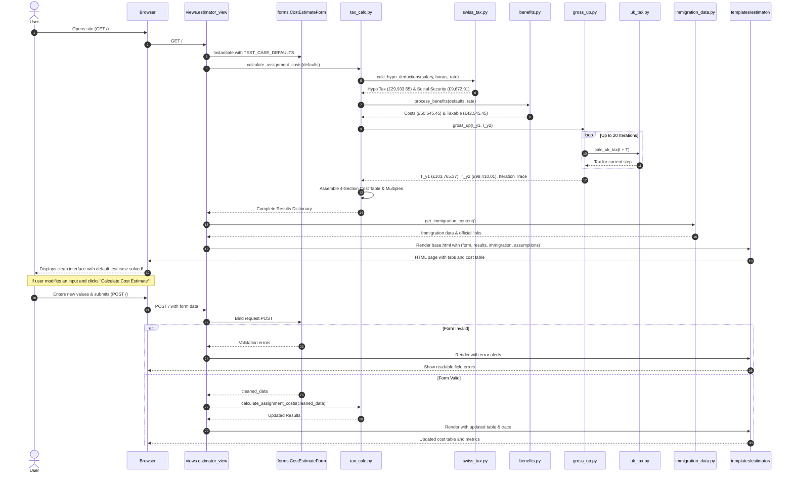

# Phase 3: Django Architecture and Data Flow Specification
**Global Mobility Cost Estimator (Switzerland → UK Assignment)**

---

## 1. Project Directory Structure

The project follows a pragmatic, monolithic Django structure. Keeping the entire logic inside one dedicated application called `estimator` keeps the project simple, clean, and immediately comprehensible to inspecting engineers.

```
Global Mobility Cost Estimator/
├── manage.py
├── requirements.txt
├── README.md
├── cozm_estimator/               # Project configuration directory
│   ├── __init__.py
│   ├── settings.py              # Minimal Django settings, SQLite, staticfiles
│   ├── urls.py                  # Root URL routing to estimator app
│   └── wsgi.py                  # WSGI entrypoint
│
└── estimator/                    # Main application directory
    ├── __init__.py
    ├── apps.py                  # EstimatorConfig
    ├── models.py                # Optional CalculationRun audit model
    ├── forms.py                 # CostEstimateForm with validation and clean methods
    ├── views.py                 # estimator_view (handles GET default & POST calculation)
    ├── urls.py                  # App URL routing ('')
    │
    ├── # Calculation Utilities (Clean separation of concerns)
    ├── tax_calc.py              # Orchestration: ties Swiss tax, benefits, gross-up, and table
    ├── swiss_tax.py             # Zurich cantonal, municipal, personal, and federal tax & social security
    ├── uk_tax.py                # 2026/27 UK income tax (progressive bands + PA taper)
    ├── gross_up.py              # Iterative loop T = UKTax(I + T) with convergence trace
    ├── benefits.py              # Benefit classification & s. 287 £8,000 relocation exemption logic
    ├── immigration_data.py      # Structured immigration content, route comparison, official links
    │
    ├── tests.py                 # Automated unit and integration tests (14 scenarios)
    │
    ├── templates/
    │   └── estimator/
    │       ├── base.html        # HTML5 layout, tab bar, vanilla JS tab switching
    │       ├── cost_tab.html    # Tab 1: Inputs form, 4-section cost table, iteration trace modal/box
    │       ├── immigration_tab.html # Tab 2: Work permit, ETA, passport, sponsor duties, fees, official links
    │       └── assumptions_tab.html # Tab 3: Detailed tax assumptions, statutory sources, limitations
    │
    └── static/
        └── css/
            └── style.css        # Custom pragmatic CSS: responsive layout, badges, tables, help text
```

---

## 2. Component Responsibilities

### Core Application Files
1. **`cozm_estimator/settings.py`**:
   * Uses standard Django 5.x/4.2 configuration.
   * `INSTALLED_APPS`: includes standard Django apps plus `'estimator'`.
   * `DATABASES`: local `db.sqlite3` for zero-configuration setup.
   * `TEMPLATES`: standard `APP_DIRS: True`.
   * `STATIC_URL = '/static/'` with `STATICFILES_DIRS`.
   * No secrets, hardcoded API keys, or cloud dependencies.

2. **`estimator/models.py`**:
   * Minimal `CalculationRun` model:
     * Stores timestamp (`created_at`).
     * Stores input parameters (base salary, bonus, exchange rate).
     * Stores key output figures (Year 1 total cost, Year 2 total cost, total assignment cost, home pay multiple).
     * Enables auditability and historical tracking without complicating the core calculation.

3. **`estimator/forms.py`**:
   * Defines `CostEstimateForm`:
     * Fields for home country/city (default: Switzerland / Zurich), host country/city (default: UK / London).
     * Base salary (default: CHF 150,000).
     * Bonus (default: CHF 20,000).
     * London monthly rent (default: £3,000).
     * Relocation allowance (default: CHF 5,000).
     * Moving costs (default: £6,000).
     * Temporary housing (default: £4,000).
     * Exchange rate (default: 1.10).
     * Start date and end date (default: 2026-04-06 to 2028-04-05).
   * Robust `clean()` validation:
     * Disallows negative salaries, negative benefits, or zero/negative exchange rates.
     * Validates date sequence (end date must be after start date).
     * Returns clear, human-readable form errors rather than unhandled 500 exceptions.

4. **`estimator/views.py`**:
   * Implements `estimator_view(request)`:
     * **On GET**: Initializes `CostEstimateForm` with the test case defaults and immediately executes the calculation so that on first page visit, the user receives an instant, complete cost estimate without having to click submit.
     * **On POST**: Binds `request.POST` to `CostEstimateForm`. If valid, runs calculation via `tax_calc.py`, saves a `CalculationRun` record, and returns the results. If invalid, re-renders the form with inline error alerts.
     * Passes `form`, `results`, `immigration_data`, and `sources` into the template context.

---

### Calculation Engine Modules (`estimator/`)

1. **`estimator/swiss_tax.py`**:
   * `calc_swiss_social_security(gross_income)`:
     * AHV/IV/EO = `gross_income * 0.053` (uncapped).
     * ALV = `min(gross_income, 148200) * 0.011` (capped at CHF 148,200).
     * Returns AHV/IV/EO, ALV, and total social security in CHF.
   * `calc_zurich_income_tax(gross_income, social_security)`:
     * Deducts social security, capped professional expenses (CHF 4,000), and insurance deduction (CHF 2,900 Cantonal / CHF 1,800 Federal).
     * Calculates base cantonal tax (*einfache Staatssteuer*) via § 35 StG ZH brackets.
     * Calculates Cantonal tax (95% multiplier) and City of Zurich municipal tax (119% multiplier).
     * Adds CHF 24 personal tax.
     * Calculates Direct Federal Tax via Art. 36 DBG brackets.
     * Returns federal, cantonal, municipal, personal, and total Swiss tax in CHF.
   * `calc_hypo_deductions(salary, bonus, exchange_rate)`:
     * Orchestrates social security and tax, converting all figures to GBP at the provided exchange rate.

2. **`estimator/benefits.py`**:
   * `process_benefits(cleaned_data, exchange_rate)`:
     * Classifies each benefit into taxable cash, taxable BIK, or exempt.
     * Converts CHF relocation allowance to GBP.
     * Computes total qualifying relocation costs (`moving_costs + temp_housing`).
     * Applies the statutory **£8,000 cap** under s. 287 ITEPA 2003:
       * Exempt portion = `min(qualifying, 8000)`.
       * Taxable excess = `max(0, qualifying - 8000)`.
     * Assembles:
       * **Year 1 Actual Employer Cost** vs. **Year 1 Taxable Benefit Value**.
       * **Year 2 Actual Employer Cost** vs. **Year 2 Taxable Benefit Value** (housing only).

3. **`estimator/uk_tax.py`**:
   * `calc_uk_tax(gross_income)`:
     * Determines Personal Allowance with the £100k taper:
       * If $G \le 100,000$: $\text{PA} = 12,570$.
       * If $100,000 < G < 125,140$: $\text{PA} = 12,570 - (G - 100,000)/2$.
       * If $G \ge 125,140$: $\text{PA} = 0$.
     * Calculates taxable income = $\max(0, G - \text{PA})$.
     * Applies 20% on the first £37,700.
     * Applies 40% on taxable income up to £125,140.
     * Applies 45% on all income exceeding £125,140.
     * Returns exact UK tax down to the penny.

4. **`estimator/gross_up.py`**:
   * `gross_up(I, tolerance=0.01, max_iter=100)`:
     * Initial seed: $T_0 = \text{calc\_uk\_tax}(I)$.
     * Loop: $T_{k} = \text{calc\_uk\_tax}(I + T_{k-1})$.
     * Tracks difference $|T_k - T_{k-1}|$, recording each step in an iteration trace list.
     * Terminates when difference $< £0.01$.
     * Returns converged tax $T$, grossed-up income $I + T$, and the full iteration trace table.

5. **`estimator/tax_calc.py`**:
   * `calculate_assignment_costs(data)`:
     * Main entry point for the view.
     * Computes Section 1: Home Pay (salary, bonus, total in CHF and GBP).
     * Computes Section 4: Hypothetical Swiss deductions (tax and social security).
     * Computes Net Home Pay = `Home Pay - Deductions`.
     * Processes Section 2: Assignment benefits and taxable values.
     * Computes Taxable Pay before gross-up ($I_1$ and $I_2$).
     * Performs Gross-Up for Year 1 and Year 2.
     * Evaluates Section 3: Host tax (grossed-up tax) and NIC (£0 under Certificate of Coverage).
     * Assembles Section 5: Summary metrics (Year 1 total, Year 2 total, Total assignment, Multiple of home pay).
     * Packages assumptions and official references.
     * Returns a complete, template-ready results dictionary.

6. **`estimator/immigration_data.py`**:
   * Structured data source providing:
     * Recommended route: Global Business Mobility: Senior or Specialist Worker.
     * Alternative route: Skilled Worker visa.
     * Business visit requirements: ETA rules, permitted activities, prohibitions.
     * Passport requirements: Valid for whole of stay, no 6-month rule.
     * Employer compliance checklist: Sponsor licence, CoS, ISC, RTW checks, reporting, record-keeping, UK payroll.
     * Comprehensive fee schedule separating employer costs from employee costs.
     * Official government links with verified URLs and anchor descriptions.

---

## 3. Data Flow Diagram



---

## 4. Template Architecture & Front-End Structure

The front end is built using clean semantic HTML and standard vanilla JavaScript (no npm, no node_modules, no heavyweight frontend frameworks).

* **`base.html`**:
  * Top header with title: **"Global Mobility Cost Estimator | TheCozm"**.
  * Accessible tab navigation bar:
    * `[ Tab 1: Cost Estimate ]`
    * `[ Tab 2: Immigration & Work Permits ]`
    * `[ Tab 3: Assumptions & Sources ]`
  * Lightweight vanilla JavaScript tab switcher:
    * Switches active class on click.
    * Stores current active tab in `sessionStorage` or URL hash so tab state persists across POST submissions.
* **`cost_tab.html`**:
  * **Left Column (Inputs)**: Clean form with labeled fields, help text underneath each field explaining what it is (e.g. why exchange rate matters, what temporary housing includes), grouped into sensible fieldsets.
  * **Right Column (Outputs)**:
    * Top summary banner: **Total 2-Year Assignment Cost (£518,598.63)**, Annual Home Pay (£154,545.45), Multiple of Home Pay (**1.68x**).
    * Four-Section Table laid out exactly in the mandated order:
      1. Home Pay (Salary, Bonus, Total).
      2. Assignment Benefits (Housing, Relocation, Moving, Temp housing, £8k exemption tag).
      3. Host Tax & Employer Charges (Grossed-up UK tax, zero NIC notice).
      4. Deductions (Hypothetical Swiss Tax, AHV/IV/EO, ALV as negative values).
    * Expandable "Gross-Up Iteration Trace" collapsible details box showing the 20-step convergence table for technical audit.
* **`immigration_tab.html`**:
  * Visual route comparison card: **Global Business Mobility (Senior or Specialist Worker)** vs. **Skilled Worker**.
  * Business Visit & ETA section with clear warnings on prohibited activities.
  * Passport validity requirements card (highlighting the "duration of stay" rule and debunking the 6-month myth).
  * Employer obligations checklist (Sponsor Licence, CoS, SMS reporting, right-to-work digital verification, UK payroll setup).
  * Cost table separating employer-borne statutory fees from employee visa fees.
  * Official source citations with direct, clickable GOV.UK links.
* **`assumptions_tab.html`**:
  * Explicit list of all 8 core assumptions.
  * Statutory references table citing legislation (ITEPA 2003, ITA 2007, DBG, StG ZH) and bilateral treaties (UK-Swiss Social Security Coordination Convention).
  * Direct working links to official government and tax authority portals.

---

## 5. Ready for Phase 3 Review

This architecture provides a clean separation of concerns, guarantees that bad inputs produce user-friendly errors, and delivers the test case solution immediately upon initial page load without requiring external dependencies or AI-generated textbook boilerplate.

**Phase 3 is complete. Ready for User Review before proceeding to Phase 4.**

